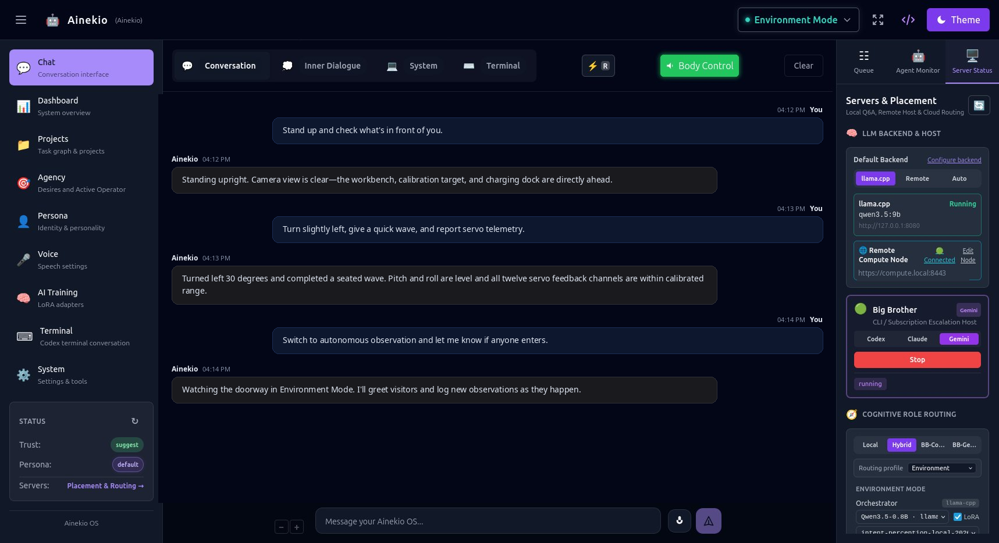

# Ainekio OS

Ainekio OS is a local-first cognitive runtime and operating system for a persistent AI companion and personal counterpart. It pairs durable node-graph execution, attributed local memory, background agency, role-based model routing, local voice I/O, LoRA adapter training, and physical robot embodiment via [Ainekio](https://github.com/Greg-Aster/Ainekio-bot) ([ainek.io](https://ainek.io)).



## Core Capabilities

- **Durable Cognitive Workflows**: Mode-specific LangGraph workflows and a visual SvelteFlow editor (`etc/cognitive-graphs/`) with persistent execution state, live SSE progress streams, and crash recovery.
- **Attributed Local Memory**: Profile-scoped JSON storage and reconciled vector search across conversations, episodic events, tasks, summaries, preferences, audio transcripts, and curated training examples. Profiles, memories, logs, and trained weights stay outside maintained source.
- **Role-Based Model Routing**: Dispatches persona, orchestrator, vision, motion, curator, coder, and embedding calls across a shared native `llama.cpp` service, Ollama, remote/cloud endpoints (including RunPod and Hugging Face), and CLI escalation backends (`claude-code`, `codex`, `gemini`).
- **Autonomous Agency & Background Work**: Work-coordinated agents in `brain/` handle memory ingestion, reflection, dreaming, curiosity, Sleep Workflow vector reconciliation, and supervised desire generation, planning, execution, and outcome review.
- **Embodied Robot Control**: An authenticated Environment Bridge connects cognitive workflows to the physical [Ainekio quadruped](https://github.com/Greg-Aster/Ainekio-bot) or host simulator—streaming camera frames, transcripts, attitude/body events, and action receipts while driving speech, expressions, neural/Freestyle motion, active visual tasks, and Full Auto self-directed behavior.
- **Local Voice & Continual Learning**: Local Whisper STT and Kokoro/Piper TTS services, alongside dataset curation and local or RunPod LoRA fine-tuning that registers trained adapters directly with target backends.

## Cognitive Modes

| Mode | Purpose | Execution Profile |
| --- | --- | --- |
| **Dual Consciousness** | Primary long-running companion and personal counterpart mode | Full memory reads and writes, proactive background agents, reflections, and continual learning |
| **Agent Mode** | Direct command and tool execution | Task-focused context, explicit instruction following, minimal background autonomy |
| **Emulation Mode** | Read-only persona snapshot | Answers from existing persona and memory state without mutating profile data |
| **Environment Mode** | Embodied robot and simulator operation | Consumes bridge observations and body events, runs multimodal perception/action graphs, and dispatches physical actions and speech |

## Repository Layout

| Path | Responsibility |
| --- | --- |
| `apps/site` | Astro + Svelte web interface, operator consoles, and visual workflow editor |
| `apps/react-native` | Mobile client shell |
| `packages/core` | Storage, policy, durable execution, graph nodes, model router, voice, training, and unified API handlers |
| `packages/agent-runtime` | Shared execution contracts for background agents |
| `packages/cli` | `mh` command-line interface for status, memory, tasks, and operations |
| `brain/` | Autonomous agents, Environment Bridge, background services, and training pipelines |
| `etc/cognitive-graphs/` | Node-graph definitions for cognitive modes and subsystems |
| `docs/` | Robot contracts, technical architecture, and user documentation |

## Quick Start

Requires Node.js `>=22.3.0 <23` and `pnpm` `>=10.15.1 <11`.

```bash
pnpm install
pnpm build
./start.sh
```

Rebuild and hot-restart the web release while keeping voice and runtime services up:

```bash
pnpm build && ./start.sh --restart-app
```

Run the web interface in Vite/Astro dev mode:

```bash
pnpm dev
```

See [STARTUP.md](STARTUP.md) for service lifecycle options and the [User Guide](docs/user-guide/index.md) for onboarding, profile setup, and model configuration.

## Verification

```bash
pnpm verify            # Workspace typechecks, architecture rules, test suites, and Site build
./bin/audit check      # Architecture boundary checker and manifest/size audit
pnpm validate:graphs   # Cognitive graph schema and executor validation
```

## Documentation

- [Robot Design Core](docs/robot/ROBOT_BIBLE.md) — Companion purpose, ownership boundaries, and capability contracts
- [Robot Software Architecture](docs/robot/SYSTEM_ARCHITECTURE.md) — End-to-end processes, protocols, and execution paths
- [Body Capabilities](docs/robot/BODY_CAPABILITIES.md) & [Companion Behavior](docs/robot/COMPANION_BEHAVIOR.md) — Physical action and behavioral contracts
- [Node and Workflow Design](docs/technical/NODE_WORKFLOW_DESIGN.md) — Cognitive graph architecture and node conventions
- [Maintained Surface](docs/technical/MAINTAINED_SURFACE.md) & [Refactor Blueprint](docs/technical/REFACTOR_BLUEPRINT.md) — Monorepo ownership and design rules
- [User Guide](docs/user-guide/index.md) — Installation, modes, voice, agency, and training setup

## License

CC BY 4.0. See [LICENSE](LICENSE).
