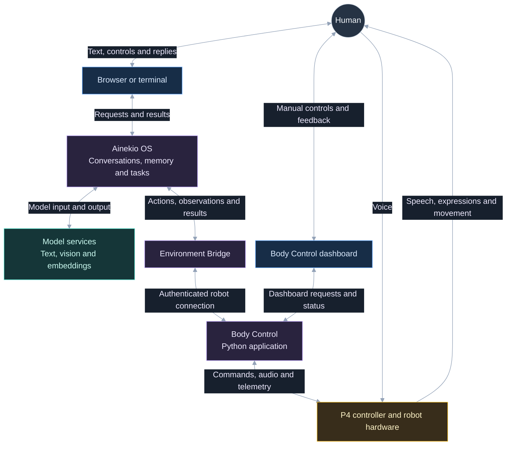
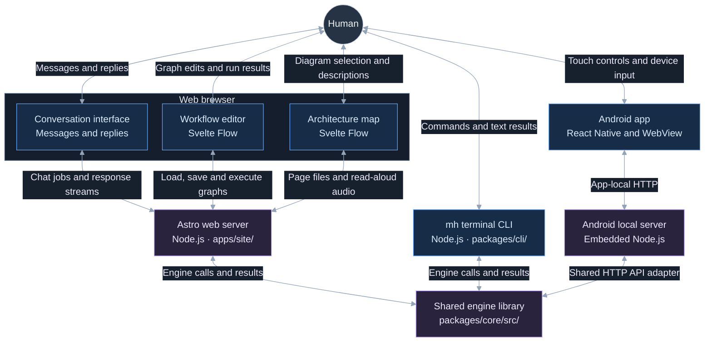
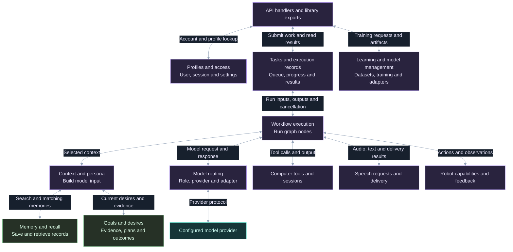
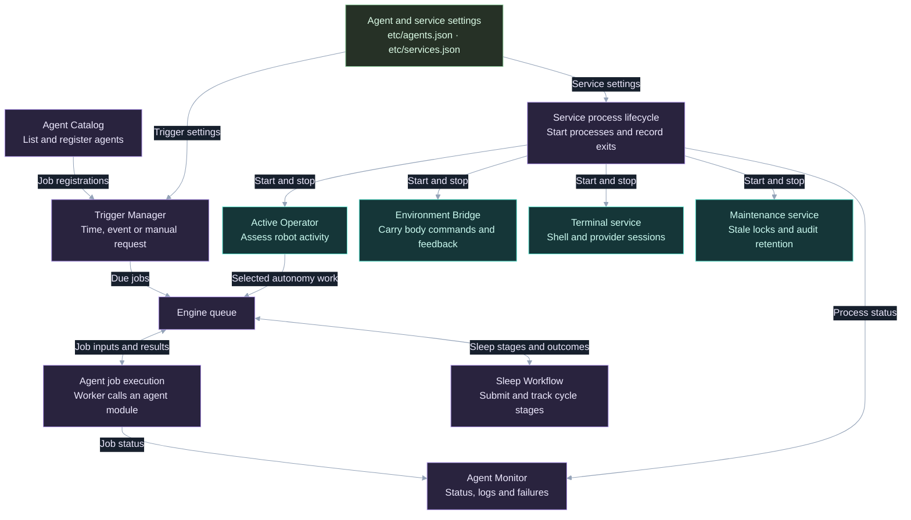
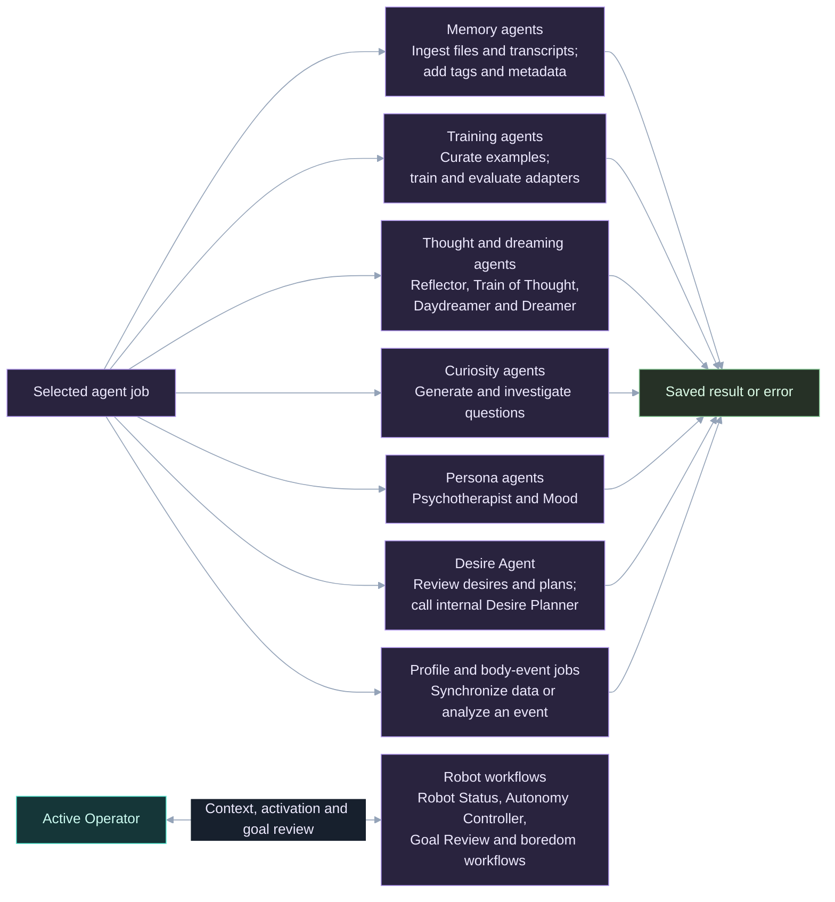
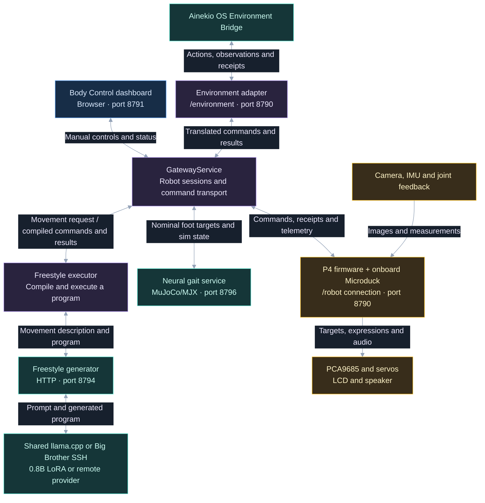
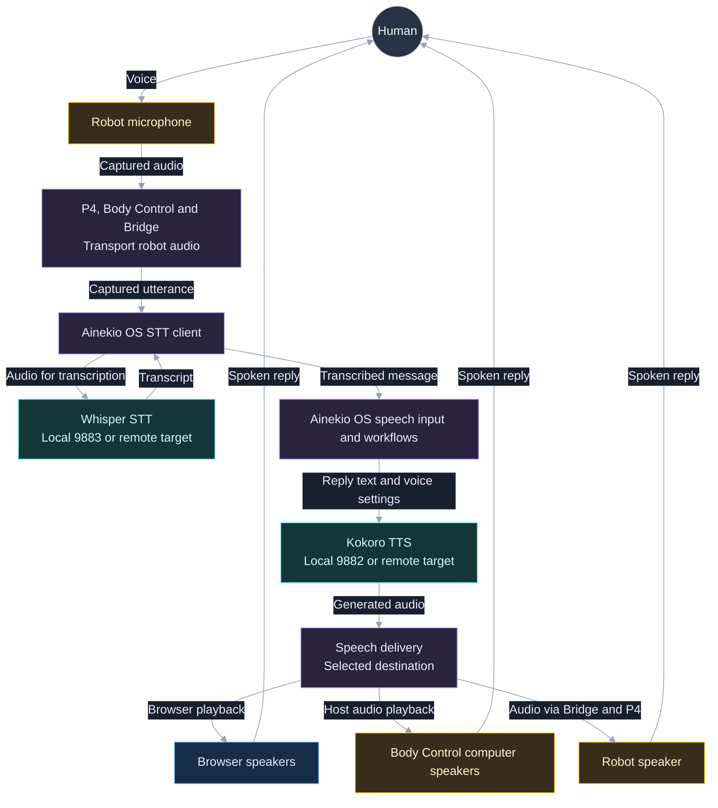
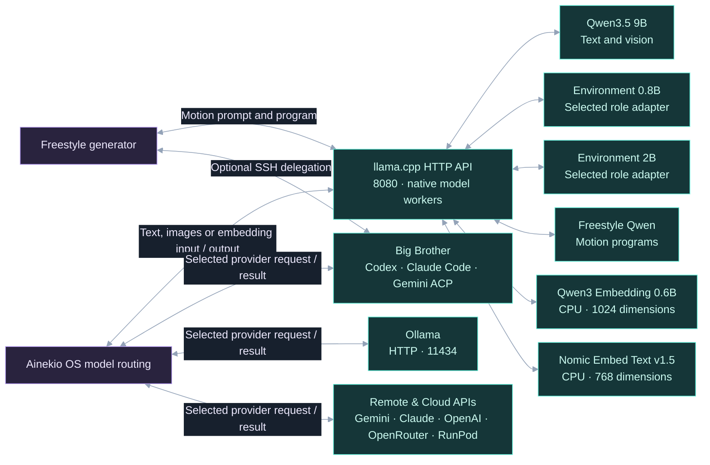
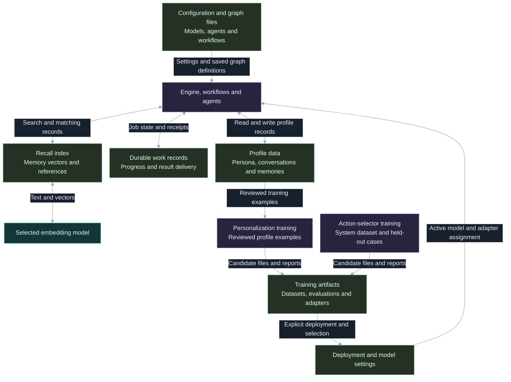

# Robot software architecture

This is the canonical software map for **V2** across Ainekio and Ainekio OS:
processes, interfaces, execution paths and state owners. V1 work is paused.
Source paths were traced on **2026-11-12**; this is not a claim that every
checkout change is deployed.
The [design core](ROBOT_BIBLE.md) owns product intent; [V2 specifications](https://github.com/Greg-Aster/Ainekio-bot/blob/dev/docs/v2-12servo/SPECIFICATIONS.md)
own the physical assembly. Read this page before changing robot software.

The Bible links the intended capability contracts; this page owns their software
wiring. The [supervised walkthrough](history/2026-11-03-supervised-walkthrough.md)
retains dated file-review and repair evidence, separate from this map.

## Processes and connections

The diagrams below separate the overview from the implementation details.
Follow the labels on the arrows to see what passes between components. Blue
boxes are interfaces, purple boxes are application code, teal boxes are model
or persistent services, amber boxes are hardware and green boxes are stored data.

- [System overview](#system-overview)
- [User interfaces](#user-interfaces)
- [Engine functions](#engine-functions)
- [Agent scheduling and services](#agent-scheduling-and-services)
- [Agent jobs and robot workflows](#agent-jobs-and-robot-workflows)
- [Body Control and movement](#body-control-and-movement)
- [Voice input and speech output](#voice-input-and-speech-output)
- [Model and embedding services](#model-and-embedding-services)
- [Stored data and training](#stored-data-and-training)

### System overview

Start here. Each box is expanded in a diagram below. Arrows name the information crossing between systems. They do not show live execution.



### User interfaces

The conversation screen, workflow editor and architecture map run in the browser. Svelte Flow draws the two node canvases; the engine executes workflow graphs.



### Engine functions

Core is a TypeScript library used by the server, CLI and workers. The branches below are available functions, not steps that every request must run.



### Agent scheduling and services

Individual agent jobs run in workers. Persistent services have their own processes. A trigger submits work; the engine queue executes it.



### Agent jobs and robot workflows

The queue selects the required job. These branches are alternatives, not a sequence. Source implementations are in `brain/agents/`; robot workflow nodes are in `packages/core/src/nodes/robot-operator/`.



### Body Control and movement

Body Control runs on the desktop or robot-local host. Freestyle's generator and the host neural gait simulator run as separate HTTP services. Firmware executes physical commands (including analytic gaits and the embedded Microduck neural policy); returned feedback establishes what happened.



### Voice input and speech output

Input and output can overlap other work. Output follows the selected audio destination, and Whisper STT / Kokoro TTS support either local ports (`9883` / `9882`) or configured remote targets.



### Model and embedding services

One `llama.cpp` service per computer exposes model aliases. Native workers load the selected weights. Desktop presets use GPU offload for generation and CPU inference for embeddings; robot-local SBCs such as Radxa Q6A maintain their own host presets.



### Stored data and training

Boxes for stored data represent files or databases, not servers. Training produces candidates; deployment and model selection determine what runs in inference.



The interactive Svelte Flow map (`/architecture` in the Site application)
is described in its [implementation notes](../../apps/site/src/components/architecture-map/README.md).
The diagrams show configured paths, not live health or deployment status. See the
[placement table](#shared-llamacpp-hosting) for the desktop/Q6A split and
[listening and speaking](BODY_CAPABILITIES.md#listening-and-speaking) for audio
destination selection.

Sources: the selected profile's `etc/models.json` and `etc/operator.json` resolved
through the [profile registry](../../packages/core/src/model-resolver.ts);
[backend configuration](../../etc/llm-backend.json),
[voice service configuration](../../etc/voice-servers.json),
the [embedding request owner](../../packages/core/src/embeddings.ts),
the [native llama.cpp provider](../../packages/core/src/providers/llama-cpp.ts),
[deployment configuration](../../etc/deployment.json), and the
[Freestyle service definition](https://github.com/Greg-Aster/Ainekio-bot/blob/dev/experiments/freestyle/ainekio-freestyle-api.service).

**Body Control is a Python application.** Its [composition root](https://github.com/Greg-Aster/Ainekio-bot/blob/dev/Master/gateway/server/__main__.py)
creates GatewayService, the environment adapter, camera processing, gait learning,
the optional host neural gait service (`8796`), and the dashboard HTTP thread.
Freestyle's generator (`8794`) is a separate HTTP service; its executor is loaded
by the dashboard into the gateway process.

**Ainekio OS spans multiple processes and clients.** Core (`packages/core/src/`)
is a shared TypeScript library imported by the Astro Node.js web server, the `mh`
CLI, and worker subprocesses. Brain supplies finite agent adapters and persistent
service entrypoints (including Environment Bridge, supervised through Agent Catalog
and Agent Monitor). The Android app embeds its own local Node.js HTTP server and
shared Core API adapter. Model servers can run locally or remotely; assigning a
model does not move durable task state to that server.

| Connection | Endpoint / owner |
| --- | --- |
| Robot → Body Control | Robot initiates authenticated `/robot`, default port **8790**; gateway assigns session epochs and command sequences |
| Operator → Body Control | Dashboard HTTP, default **8791**, independent of Ainekio OS's web UI |
| Bridge → Body Control | Authenticated `/environment` on **8790**; gateway accepts loopback peers. Remote SSH/Cloudflare forwarding terminates there |
| Bridge ↔ Ainekio OS Core | Authenticated `/api/environment-bridge/*`: observation and result POSTs; `/stream` carries outbound work |
| Freestyle executor → generator | Configured HTTP endpoint, default `127.0.0.1:8794`; generator calls shared `llama.cpp` or Big Brother over SSH |
| Gateway ↔ neural gait service | Local HTTP/MuJoCo policy service, default `127.0.0.1:8796` |

These are bidirectional information paths, not a serial execution sequence.
Speech, sensing, motion and inference can overlap. For physical V2 startup, use
the [startup guide](https://github.com/Greg-Aster/Ainekio-bot/blob/dev/docs/STARTUP.md).

## Shared llama.cpp hosting

Each computer running local `llama.cpp` inference uses one `llama-cpp.service` and
one host-local preset (conventionally `~/.config/llama.cpp/models.ini`). Systemd
owns the host service lifetime; [`bin/llama-cpp-services`](../../bin/llama-cpp-services)
is its installation and start entrypoint. The unit executes the native
`llama-server` binary directly, independent of Ainekio OS or Body Control.

Model Resolver/Registry own role assignments, capabilities, model aliases,
endpoint placement and request-local LoRA selection. The provider bridge and
[`providers/llama-cpp.ts`](../../packages/core/src/providers/llama-cpp.ts) transport
Ainekio OS requests. Freestyle's [generator](https://github.com/Greg-Aster/Ainekio-bot/blob/dev/experiments/freestyle/generator.py)
builds motion inputs, decodes results and calls `/v1` directly (or delegates over SSH
to Big Brother via `big_brother.py`), separate from its compiler, executor and recordings.

| Arrangement | Ainekio OS client | Freestyle generator client |
| --- | --- | --- |
| Both applications on desktop | Desktop service root, e.g. `http://127.0.0.1:8080` | Same desktop listener plus `/v1`; selects its motion alias (or Big Brother SSH) |
| Ainekio OS on desktop, Body Control on Q6A | Configured desktop service | Q6A's own service plus `/v1` (or SSH to desktop Big Brother); Q6A loopback refers to Q6A |

The host preset defines one section per deployment with absolute artifact paths,
explicit aliases, `load-on-startup = false`, and per-model context, mmproj, KV,
GPU, parallelism, reasoning, sampling and LoRA initialization settings. Keep
model-specific settings in their preset sections rather than global router
arguments. Native demand loading and idle sleep own weight residency. Inventory
and health reads do not load weights; model-qualified property or adapter reads
can load the selected worker. The service runs with `--models-max 0` so router
mode does not impose an artificial model-count eviction cap alongside actual
hardware memory limits.

Native router mode spawns inference worker processes per loaded model. The
adaptive-KV, proxy-cancellation, and number-sign schema patches live in
[`shared-host-kv.patch`](../../external/llama.cpp/shared-host-kv.patch),
[`server-cancellation.patch`](../../external/llama.cpp/server-cancellation.patch), and
[`json-schema-number-sign.patch`](../../external/llama.cpp/json-schema-number-sign.patch).

Install the shared host service from the Ainekio OS checkout:

```sh
./bin/llama-cpp-services install /absolute/path/to/llama-server \
  --models-preset /absolute/path/to/models.ini \
  --host 127.0.0.1 --port 8080 --models-max 0
systemctl --user start llama-cpp.service
```

App startup may idempotently start the local `llama-cpp.service` for a selected
loopback deployment without scanning units or preloading weights. Freestyle's
generator unit uses `Wants=llama-cpp.service` without `PartOf` or `BindsTo`.
Stopping either client application leaves `llama-cpp.service` running; host
maintenance uses `systemctl --user stop|restart llama-cpp.service`. Note that
`/models?reload=1` reloads presets and can unload changed workers. Adapter
discovery passes `?model=...`, and inference requests pass the selected model
and per-request `lora` list without mutating global adapter scales.

### Native embeddings and indexes

The Embedder role calls `/v1/embeddings` through the shared native service. The
two GGUF aliases—Qwen3 Embedding 0.6B (1024 dimensions, last-token pooling,
32768-token capacity) and Nomic Embed Text v1.5 (768 dimensions, mean pooling,
2048-token capacity)—use `device = none` and `gpu-layers = 0` for CPU execution
and return native L2-normalized vectors without application character truncation
or secondary fallback services. Mobile Core also acts as a client of its
configured native endpoint. `vector-index.ts` enforces vector compatibility and
rebuilds affected indexes from original memory records when the embedding model
changes.

## Follow an operation

### A request to move

1. Human input or an admitted autonomous intention reaches
   [`environment-mode.json`](../../etc/cognitive-graphs/environment-mode.json).
   Intent selects relevant context; Task Decision selects a program. The graph
   can use current execution, conversation, persona, memory and robot observations.
2. [`robot-active-task-mode.json`](../../etc/cognitive-graphs/robot-active-task-mode.json)
   advances that program inside the existing durable execution. Its
   [Active Task node](../../packages/core/src/nodes/environment/active-task.node.ts)
   uses Core's [environment contract/store](../../packages/core/src/environment-interface/)
   to admit actions and retain their identities.
3. [Environment Bridge](../../brain/agents/environment-bridge/core.ts) consumes
   Core's stream and sends the action to the gateway's
   [environment adapter](https://github.com/Greg-Aster/Ainekio-bot/blob/dev/Master/gateway/environment_adapter/server.py).
   The adapter translates the semantic request (including direct `stop` with `detach: true` when requested) and correlates its result.
4. For `requestMotion.description`,
   [`GatewayService.request_motion`](https://github.com/Greg-Aster/Ainekio-bot/blob/dev/Master/gateway/server/service.py)
   calls the [Freestyle executor](https://github.com/Greg-Aster/Ainekio-bot/blob/dev/experiments/freestyle/bridge.py).
   Its [generator](https://github.com/Greg-Aster/Ainekio-bot/blob/dev/experiments/freestyle/generator.py) produces a
   motion program from the request and observations. The executor compiles and
   submits targets through the same gateway connection.
5. P4's [controller](https://github.com/Greg-Aster/Ainekio-bot/blob/dev/Slave/firmware/esp32p4-wifi6/main/controller.c)
   receives the wire command. Its [body executor](https://github.com/Greg-Aster/Ainekio-bot/blob/dev/Slave/firmware/esp32p4-wifi6/main/body.c)
   owns motion progress, calibrated output and measured target tracking; the
   [PCA9685 driver](https://github.com/Greg-Aster/Ainekio-bot/blob/dev/Slave/firmware/esp32p4-wifi6/components/ainekio_pca9685/pca9685.c)
   writes servo signals. LLM token generation does not clock servo frames.
6. Firmware receipts and telemetry return through GatewayService, adapter and
   Bridge to the same Core action/execution. Active Task consumes them; the
   [Goal Review graph](../../etc/cognitive-graphs/robot-goal-review-mode.json)
   assesses an eligible unfinished objective. Submission, execution completion
   and achievement of a physical goal are different results.

**Motion ownership:** Freestyle owns description-based motion, startup/wake and
stall correction requests. Inactivity rest/release is body-local, as defined in
[the motion contract](BODY_CAPABILITIES.md#motion-and-posture). The manual Motion
Library selector affects explicit manual controls without redirecting Ainekio OS
requests. Native motion, onboard Microduck neural walking, and low-level manual
controls remain available through the same P4 owners. An unavailable generator
is reported rather than silently substituting a library movement. See the
[Freestyle contract](https://github.com/Greg-Aster/Ainekio-bot/blob/dev/experiments/freestyle/README.md) for model,
compiler, training and deployment details.

### Contracts at the handoffs

| Boundary | Responsibility and reason | Behavior a change must preserve |
| --- | --- | --- |
| Graph → Core execution | Graphs compose model-selected behavior; Core owns admission and durable progress, so a second agent cannot independently claim the same objective | Preserve execution/effect/work identities, selected ordering and independent concurrent work; a graph return is not automatically goal completion |
| Core → Bridge → adapter | Core owns the requested action; Bridge transports it; the adapter translates it for the selected body | Preserve action identity, body ownership, admission, cancellation and results across reconnect; transport code does not reinterpret the goal |
| Gateway → Freestyle → P4 | Freestyle turns semantic motion into a program; gateway sends it; P4 owns physical execution and calibration | Generation failure is reported; manual library selection does not redirect semantic requests; generated targets are not measured positions |
| P4 → Core | Device and gateway evidence establishes progress and outcomes; Core correlates it to the originating work | Acceptance, termination, failure, unknown outcome and goal achievement remain distinguishable |
| Core → UI / model context | UI projects state and models receive attributed evidence | Preserve source, speaker, time and uncertainty; displaying success cannot create a receipt |

Executable schemas live in the [protocol](https://github.com/Greg-Aster/Ainekio-bot/blob/dev/Slave/software/protocol/README.md)
and [Core environment types](../../packages/core/src/environment-interface/types.ts);
joint positions, socket mappings and electrical units live in the
[V2 specifications](https://github.com/Greg-Aster/Ainekio-bot/blob/dev/docs/v2-12servo/SPECIFICATIONS.md#joints-units-and-calibration).

Core's durable execution/effect identity maps to Coordinator work and the adapter
action; the gateway records the Freestyle job or robot session and sequence that
received it. Reconnect resumes delivery by those identities without repeating
the movement request. Cancellation and manual takeover address the original work
even if selection has changed, and a Stop command does not retroactively prove an
earlier movement's outcome. See
[paired qualification](QUALIFICATION.md#cancellation-and-reconnect).

### Hearing, speaking, seeing and body events

- **Hearing:** P4 microphone capture → gateway audio transport → Environment Bridge
  transcription through Core's STT owner → attributed observation → Environment
  Mode. A transcript and a body sensor event retain different source identities.
- **Speaking:** graph response → Core [robot speech delivery](../../packages/core/src/tts/robot-speech.ts)
  and configured TTS → Bridge → gateway speech transport → selected robot or host
  playback. Playback receipts return to the originating work. Browser audio uses
  the existing browser delivery selection.
- **Seeing:** P4 camera frames → gateway [camera plugin](https://github.com/Greg-Aster/Ainekio-bot/blob/dev/Master/gateway/plugins.py)
  and configured [perception owner](https://github.com/Greg-Aster/Ainekio-bot/blob/dev/Master/gateway/perception.py) →
  adapter/Bridge → selected graph image or observation. Acquisition, recognition,
  metric estimates and retained image identity are separate contracts.
- **Body events:** P4 IMU/feedback/device events → gateway event owner → Bridge →
  configured event workflow. The workflow selects the response. Telemetry also
  updates subscribed active tasks without becoming a new user conversation.

## Where a change belongs

Paths below are implementation owners, not proposed replacement services.

| Responsibility | Existing owner |
| --- | --- |
| P4 initialization and peripheral composition | Ainekio [`main/app_main.c`](https://github.com/Greg-Aster/Ainekio-bot/blob/dev/Slave/firmware/esp32p4-wifi6/main/app_main.c), `board.c`, `controller.c`; `components/ainekio_p4_media/` (including `imu.c`), `main/servo_feedback.c`, `main/display.c` |
| V2 kinematics, postures, analytic gaits and onboard Microduck neural gait | Ainekio [`Slave/software/models/v2-12servo/`](https://github.com/Greg-Aster/Ainekio-bot/tree/dev/Slave/software/models/v2-12servo) (`motions/microduck/`); P4 `body.c` owns 50 Hz device execution |
| Wire fields, joint order and compatibility | Ainekio [`Slave/software/protocol/`](https://github.com/Greg-Aster/Ainekio-bot/tree/dev/Slave/software/protocol), including `joints_v2.py`; Ainekio OS [`environment-interface/types.ts`](../../packages/core/src/environment-interface/types.ts) owns its semantic side |
| Connections, authentication, command sequences and body receipts | Ainekio [`Master/gateway/server/`](https://github.com/Greg-Aster/Ainekio-bot/tree/dev/Master/gateway/server); adapter `translation.py` and `action_receipts.py` own semantic translation/correlation |
| Host neural gait simulation, training and policy service | Ainekio [`Master/gateway/neural_gait/`](https://github.com/Greg-Aster/Ainekio-bot/tree/dev/Master/gateway/neural_gait) (`server.py` on port `8796`, `microduck.py`, `pupper_mjx_actor.py`) and [`gait_learning_service.py`](https://github.com/Greg-Aster/Ainekio-bot/blob/dev/Master/gateway/gait_learning_service.py) |
| Authenticated robot maintenance HTTP | Ainekio [`robot_learning_transport.py`](https://github.com/Greg-Aster/Ainekio-bot/blob/dev/Master/gateway/robot_learning_transport.py); gait service owns its supplied persistent transport, while Freestyle owns its supplied sparse transport |
| Learned movement generation and execution | Ainekio [`experiments/freestyle/`](https://github.com/Greg-Aster/Ainekio-bot/tree/dev/experiments/freestyle), loaded by `dashboard/server.py`; this is an active runtime dependency despite the directory name |
| Host selection, reconnect and tunnel lifecycle | Ainekio OS [connection lifecycle](../../brain/agents/environment-bridge/), [`forwarder.ts`](../../brain/agents/environment-bridge/forwarder.ts) and Bridge `core.ts` |
| Work admission and finite execution | Core [`queue/queue-system.ts`](../../packages/core/src/queue/queue-system.ts), `execution-engine.ts`; other processes submit through `work-submission.ts` |
| Graph execution, suspension, results and recovery | Core [`graph-executor.ts`](../../packages/core/src/graph-executor.ts) and [`durable-execution/`](../../packages/core/src/durable-execution/) |
| Task-selection schema, validation, context and planning-delegation contract | Core [`environment-interface/task-selection.ts`](../../packages/core/src/environment-interface/task-selection.ts); graph nodes and training-evidence readers consume this domain contract |
| Cognitive composition and node behavior | [`etc/cognitive-graphs/`](../../etc/cognitive-graphs/README.md) connects registered [`Core nodes`](../../packages/core/src/nodes/); graph JSON is composition, not a second implementation |
| Model role resolution and transport | Core [`model-router.ts`](../../packages/core/src/model-router.ts), `model-roles.ts`, `llm-backend.ts`, [`providers/bridge.ts`](../../packages/core/src/providers/bridge.ts) |
| Agent registration and process lifecycle | Core [`Agent Catalog`](../../packages/core/src/agent-catalog-definitions.ts), `agent-process-runner.ts`; [`brain/agents/`](../../brain/agents/README.md) supplies adapters |

Site and CLI remain interfaces over Core.

## State, memory and learning

Core's [audit owner](../../packages/core/src/audit.ts) stores structured activity
history separately from memories and execution receipts. Audit Viewer, training
logs and explicit agent diagnostics share its paged reader; agent run statistics
come from retained Coordinator receipts. The event bus transports audit events
live without storing duplicate audit history. Machine `etc/logging.json` owns
recording and retention; Maintenance and housekeeping use that policy.

| State | Producer and consumer | Release / retention responsibility |
| --- | --- | --- |
| Device calibration, peripherals and Wi-Fi | P4 configuration/NVS → physical executor and device setup | Device-owned configuration survives host reconnect; replacing a model or clearing a host queue does not erase it |
| Adapter action and delivery receipts | [ActionReceipts](https://github.com/Greg-Aster/Ainekio-bot/blob/dev/Master/gateway/environment_adapter/action_receipts.py) → Bridge/Core admission and evidence ingestion | Acknowledgement deletes the delivery copy. Action history remains until terminal, its observation is recorded, no delivery refers to it, and the existing age policy permits pruning. [Adapter recovery](https://github.com/Greg-Aster/Ainekio-bot/blob/dev/Master/gateway/environment_adapter/server.py) invokes that pruning; unresolved outcomes remain recoverable |
| Coordinator work and terminal results | [Queue manager](../../packages/core/src/queue/unified-queue-manager.ts) / [persister](../../packages/core/src/queue/queue-persister.ts) → executor and [durable receipt ingestion](../../packages/core/src/durable-execution/work-results.ts) | A terminal worker releases execution capacity. A durable result remains until its execution owner has committed the correlated receipt and acknowledges delivery; remaining terminal history follows the existing queue history policy |
| Goals, checkpoints, effects and evidence references | [Execution store](../../packages/core/src/durable-execution/store.ts), profile `executions.sqlite` → graph resume, result consumers and history readers | Pending delivery, unresolved effects and live writers prevent retirement. [Checkpointer](../../packages/core/src/durable-execution/checkpointer.ts) retention removes eligible terminal history and then unreferenced observations/blobs; [recovery](../../packages/core/src/durable-execution/recovery.ts) supplies unfinished-work exclusions |
| Conversation, persona and persistent experience | [Buffer admission](../../packages/core/src/buffer-admission.ts), [memory](../../packages/core/src/memory.ts) and profile owners → selected context and learning | Domain retention is independent of worker completion. Execution cleanup does not erase conversation or learned facts; attribution and deduplication belong to these owners |
| Training examples, model artifacts and CAD | Existing Core/Brain training owners, Freestyle dataset/deployment owners and Ainekio hardware owners → evaluation, serving, rollback or manufacturing | A completed training job does not make its dataset, active weights or rollback artifact an orphan. Verify references and intended retention at that owner before removal |

Missing release behavior must be repaired at its producing owner and verified
through normal consumption rather than compensated for with a separate cleanup
sweep.

Autonomy, Desire, reflection and sleep initiate work through the Coordinator and
graph owners. Active Operator assesses which operations to request, Desire owns
reviewed multi-step plans, and Active Task executes body programs. Standing
persona context, Orchestrator source selection, and context reuse across
Active Operator and Environment Mode follow the
[assessment context contract](COMPANION_BEHAVIOR.md#active-operator-execution-contract)
and [Full Auto contract](COMPANION_BEHAVIOR.md#full-auto-continuity--owner-contract).
[Models and learning](MODELS_AND_LEARNING.md) owns the learning and activation
contracts.

## Intended boundaries and remaining distribution work

P4 owns local physical execution; Body Control owns the selected body and learned
motion execution; Ainekio OS owns cognition and durable objectives. Model-backed
behavior selection remains with the relevant models, while transport and UI
layers report observations and outcomes.

One Environment Bridge owns the gateway connection. With **Follow the same robot
across saved hosts** enabled, it watches the configured local host and saved SSH
or Cloudflare route concurrently while maintaining a single Body Control action
stream. An authenticated host remains usable without a physical robot (including
for host computer speech). A host advertising the selected robot takes precedence
over a host without one; when that body moves hosts, the bridge reconnects to the
new host. Selecting an explicit robot identity persists across restarts; without
one, automatic mode follows the first available body for that process lifetime
and never switches to a different robot when unavailable. Manual mode connects
only to the explicitly selected host (manual Local closes the remote forwarder).
WireGuard remains an OS-managed interface.

Authenticated Body Control availability, physical robot availability, and Core
stream readiness are reported separately. Agent Monitor exposes Environment
Bridge connection and transcription diagnostics; Chat does not display a
persistent disconnected-robot banner. A firmware listening indicator proves
capture, not delivery. Admitted work retains correlated receipts across
reconnect without replaying physical actions, and new unsolicited input requires
a connected recipient.

Cross-installation migration of active goals, replicated durable state, and
control handoff remain design proposals in
[DISTRIBUTED_ROBOT_FOUNDATION.md](https://github.com/Greg-Aster/Ainekio-bot/blob/dev/docs/DISTRIBUTED_ROBOT_FOUNDATION.md).
See [Maintained Surface](../technical/MAINTAINED_SURFACE.md) for runtime
constraints, [Refactor Blueprint](../technical/REFACTOR_BLUEPRINT.md) for the
repair method, and [qualification](QUALIFICATION.md) for acceptance checks.
